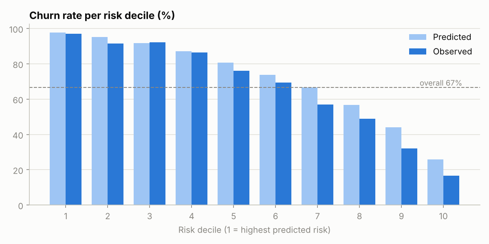
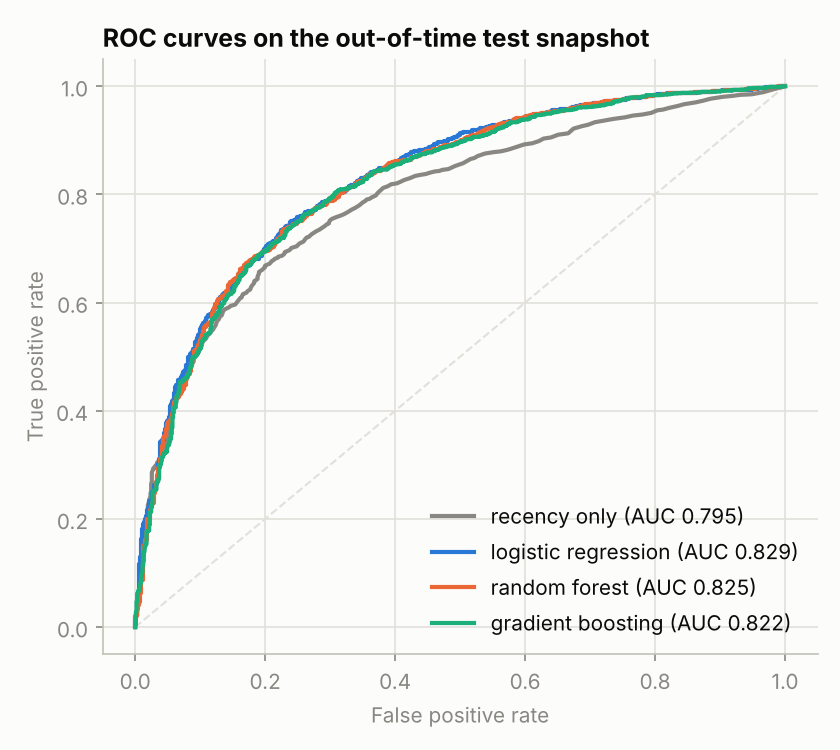

# Customer Churn ML Pipeline

[](https://github.com/mhmmdhaghjoo/customer-churn-ml-pipeline/actions/workflows/ci.yml)

Which customers of an online shop will not order again in the next 90 days?
This project answers that with a tested, installable Python package instead of
a notebook: data validation, leakage-safe feature snapshots, hypothesis tests,
K-Means segmentation, four competing models and an out-of-time evaluation,
all behind one command.



## Result in short

Trained on three earlier snapshots (October 2024 to April 2025) and tested on
a later one (October 2025, 2,931 customers, 66.7 % churn):

| Model | ROC AUC | PR AUC | Brier score |
|---|---:|---:|---:|
| Recency only (baseline) | 0.795 | 0.883 | 0.175 |
| **Logistic regression** | **0.829** | **0.898** | **0.158** |
| Random forest | 0.825 | 0.893 | 0.160 |
| Gradient boosting | 0.822 | 0.892 | 0.160 |

- The simplest full model wins. Logistic regression beats the "days since last
  order" baseline by 0.034 ROC AUC (95 % bootstrap interval 0.025 to 0.043),
  and the tree ensembles do not improve on it.
- The ranking is useful: 97 % of customers in the highest-risk decile churn,
  17 % in the lowest.
- Recency, number of orders and tenure carry almost all of the signal
  (permutation importance). Country, channel and age add nothing, which the
  hypothesis tests had already suggested before any model was fitted.
- Known weakness: the model over-predicts churn for low-risk customers
  (26 % predicted against 17 % observed in the lowest decile). The test window
  is the Christmas quarter, when more customers come back than in the
  training windows. A production version would need seasonal features or
  recalibration.



## The data

The data is **simulated** by `churn simulate` (5,000 customers, 200 products,
about 37,000 order lines over 2023 to 2025, fixed seed). Customers belong to
hidden behavioural types that determine how often they order and when they
stop; the type is never exported. I used a simulation so the project can be
published and rerun by anyone. The numbers above describe the simulation, not
a real company, and the same simulator feeds my
[SQL warehouse project](https://github.com/mhmmdhaghjoo/online-retail-sql-warehouse).

## How it works

```
simulate ─▶ validate ─▶ snapshots ─▶ hypothesis tests ─▶ segments ─▶ models ─▶ evaluation ─▶ reports/
```

| Module | Responsibility |
|---|---|
| `churn/simulate.py` | Generates the shop data |
| `churn/validate.py` | Schema and integrity checks; reports all problems at once and stops the run |
| `churn/features.py` | One row per customer as of a cutoff date: 13 numeric and 2 categorical features, plus the label |
| `churn/stats.py` | Mann-Whitney U tests with Holm correction and effect sizes; chi-square tests with Cramér's V |
| `churn/segment.py` | K-Means on log-scaled RFM, k chosen by silhouette score |
| `churn/model.py` | scikit-learn pipelines with imputation, scaling and encoding inside the pipeline |
| `churn/evaluate.py` | ROC AUC, PR AUC, Brier score, lift, decile table, bootstrap comparison of two models |
| `churn/pipeline.py` | Orchestrates the run and writes every artefact |
| `churn/cli.py` | `churn simulate` and `churn run` |

### Design decisions

- **Snapshots instead of a random split.** Features use only orders before a
  cutoff date and the label only the 90 days after it. The model is tested on
  a later snapshot than it was trained on, which is how it would be used.
  `Settings` refuses a configuration in which training labels overlap the
  test snapshot, and a unit test proves that adding future orders does not
  change any feature.
- **A baseline that is hard to beat.** Every model is compared with a
  one-feature recency model, and the gain is reported with a confidence
  interval.
- **Preprocessing inside the pipeline.** Imputation and scaling are fitted on
  training data only and are saved together with the model.
- **Honest statistics.** The hypothesis tests run on one snapshot, because
  pooling snapshots counts the same customer several times and inflates
  significance.

### Segments

K-Means finds three groups in the October 2025 snapshot:

| Segment | Customers | Median orders | Median revenue | Share of revenue | Churn rate |
|---|---:|---:|---:|---:|---:|
| Frequent buyers | 852 | 7 | EUR 1,051 | 69 % | 48 % |
| Recent newcomers | 515 | 2 | EUR 268 | 11 % | 44 % |
| Fading one-time buyers | 1,564 | 1 | EUR 160 | 20 % | 84 % |

## Run it

Requires Python 3.10 or later.

```bash
pip install -e ".[dev]"
make data     # churn simulate --out data/raw --seed 42
make run      # churn run  ->  reports/
make test     # 20 tests
make lint     # ruff + mypy
```

All tables behind the numbers above are in `reports/` (`model_comparison.csv`,
`deciles.csv`, `feature_importance.csv`, `segments.csv`, `tests_numeric.csv`,
`tests_categorical.csv`, `metrics.json`). Results come from seed 42; other
library versions can shift them slightly.

## Engineering practices

`src/` layout with `pyproject.toml` and a console script, type hints checked
with mypy, ruff for linting and formatting, logging instead of `print`, a
custom exception for invalid input with a non-zero exit code, pytest unit
tests with hand-calculated expectations plus an end-to-end test, and GitHub
Actions running lint and tests on Python 3.10 and 3.12.

## Related projects

This is one of three projects built around the same simulated online shop:

- [Online Retail SQL Warehouse](https://github.com/mhmmdhaghjoo/online-retail-sql-warehouse): the data warehouse: raw exports to a tested star schema and business analyses in SQL
- **Customer Churn ML Pipeline** (this repository): the predictive model: churn prediction as a tested Python package
- [Text-to-SQL Assistant](https://github.com/mhmmdhaghjoo/text-to-sql-assistant): the natural-language interface: LLM-written SQL with a read-only guard and an evaluation set

Two more projects:

- [Checkout A/B Test (R)](https://github.com/mhmmdhaghjoo/checkout-ab-test-r): an A/B test of a new checkout in R, from power analysis to a Bayesian rollout recommendation

- [Employee Turnover Analytics](https://github.com/mhmmdhaghjoo/employee-turnover-analytics): people analytics on ten years of HR records, with survival analysis, risk models and a fairness audit

More about me: [mhmmdhaghjoo.github.io](https://mhmmdhaghjoo.github.io) and [github.com/mhmmdhaghjoo](https://github.com/mhmmdhaghjoo)

## Licence

MIT

Author: Mohammad Haghjoo
